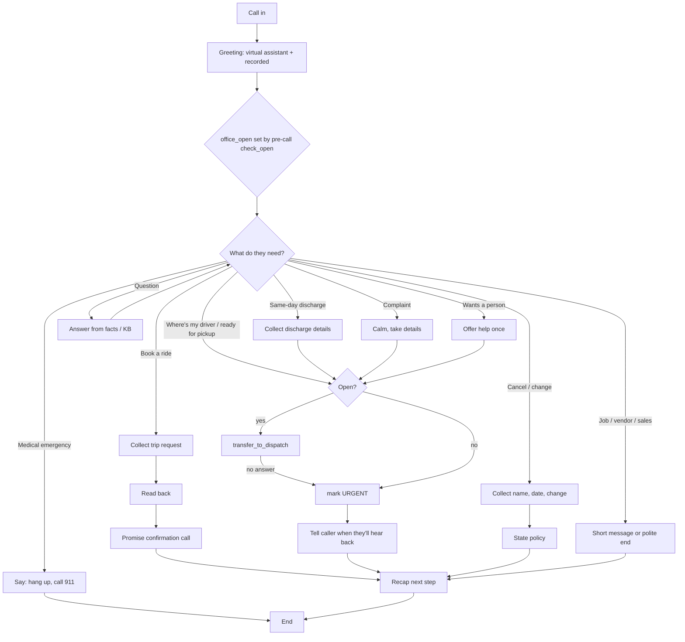

Built v0 2026-10-20 with suggested answers as defaults (see ../brief.md Assumptions). `[[OWNER]]` markers show what the owner's answers will replace.

# Kedali Med Transportation: Call flow

## Greeting
"Thanks for calling Kedali Medical Transportation. I'm the virtual assistant, and this call is recorded. How can I help you today?"
- `check_open` runs as a Retell **pre-call** tool before the first word and sets `{{office_open}}` / `{{next_open}}`. (It was an in-call tool, but the LLM sometimes skipped it.) After hours, add: "Our office is closed right now, but I can take your ride request or get an urgent message to the team."
- [[OWNER: real hours | default: office Mon–Fri 9 am–6 pm America/Chicago]]

## Branches

**1. Book a ride** (most common)
- **Collect, one at a time and skipping anything already said:**
  - rider's name, and the caller's name and relationship if different
  - callback number (confirm `{{user_number}}`)
  - pickup address (apartment or unit, where to wait, stairs)
  - destination name and address
  - appointment date and time
  - one-way or round trip, and for the return a set time or "call when done"
  - recurring? (e.g. dialysis Mon/Wed/Fri)
  - mobility: walks, cane or walker, own wheelchair (manual or power), scooter, or other
  - companions riding
  - payment: Medicaid (plan name + Medicaid ID), private pay, or facility
  - anything else the driver should know (oxygen, sedation, needs help to the door)
- **Check the service area:** in the listed counties, it's fine. Elsewhere, or out of state, say "I'll pass it to the team to confirm we can cover that trip."
- **Stretcher, bariatric or oxygen:** "I'll note that and the team will confirm whether we can do it." [[OWNER: confirm unsupported services | default: not offered, the team checks]]
- **Medicaid:** [[OWNER: book directly vs plan broker | default: take plan + ID, the team checks coverage]]
- **Read back** the whole trip in one go.
- **Close:** "I've sent your ride request to our team. They'll call you at <number> to confirm the pickup time [[OWNER: confirmation promise | default: within 2 business hours]]."
- **Function:** none mid-call. The request is delivered post-call (`trip_request` fields → notify-owner email + text).
- **If delivery fails:** the post-call webhook retries. Validation tests delivery end to end.
- **Never** say the ride is booked or give a pickup time as final.

**2. Where's my driver / ready for pickup** (urgent)
- **Collect:** name, pickup location right now, appointment or ready time, callback number.
- **Open:** "I'm sorry you're waiting. Let me get you to our dispatcher right now." Then `transfer_to_team` (warm, with a whisper: "Rider <name> waiting at <location>, ride was for <time>").
- **No answer, or closed:** mark urgent (post-call `urgent` flag → notify-owner text). Then: "I've sent an urgent alert to the team. Someone will call you back at <number> [[OWNER: urgent callback promise | default: as soon as possible, within 15 minutes]]." If the rider is unsafe (cold, unwell), the emergency rule applies.
- [[OWNER: dispatch / on-call number and hours | default: owner's mobile during hours, alert-only after hours]]

**3. Same-day hospital discharge** (urgent; usually facility staff)
- **Collect:** facility name, caller's name, role and direct number, patient name, discharge time, mobility (wheelchair? stretcher?), destination, payer.
- **Then:** same as branch 2 (transfer if open, otherwise an urgent alert).

**4. Cancel or change a ride**
- **Collect:** rider name, ride date and time, the change (cancel / new time / new address), callback number.
- **Identity:** get the rider name plus the pickup address or date before discussing an existing ride. Don't read out details the caller didn't give.
- **Policy:** [[OWNER: notice + cancellation policy | default: "Thanks for letting us know early. Please cancel at least 24 hours ahead when you can."]]
- **Same-day cancellation:** treat as urgent (the urgent flag), so a driver isn't sent.
- **Otherwise:** deliver post-call. Close: "I've passed that to the team, and they'll confirm."

**5. Questions** (FAQ, from the prompt and the knowledge base)
- **Topics:** service area, wheelchair, companions ("usually yes, if there's room; mention it when booking"), Medicaid ("yes, for eligible riders; the team checks coverage"), airport and long-distance, hours, how far ahead to book.
- **Prices:** [[OWNER: quotable rates | default: "The team gives the exact price when they confirm your ride."]]
- **Unknown:** "I don't have that, but I'll have the team call you back." Log it as `unanswered_question`.

**6. Medical emergency** (any branch)
- **Triggers:** chest pain, can't breathe, unconscious or unresponsive, stroke signs, severe bleeding, a fall with injury, "I think I'm dying".
- **Say first:** "That sounds like an emergency. Please hang up and call 911 right now." Then end, if they're in danger.

**7. Complaint**
- Acknowledge without arguing or admitting fault, and take the details.
- **Open:** transfer to dispatch or the owner.
- **Closed:** take a message, with urgency set by the caller.

**8. Wants a person**
- Offer help once. If they ask again: transfer during hours, otherwise take a message.

**9. Job seekers, vendors, sales**
- **Job seekers:** "Please email info@kedalimedtransport.com."
- **Vendors:** take a brief message.
- **Robocalls and sales:** end politely.

## Closing
Recap the next step ("The team will call you at … to confirm"), then ask "Anything else I can help with?" and end the call.
